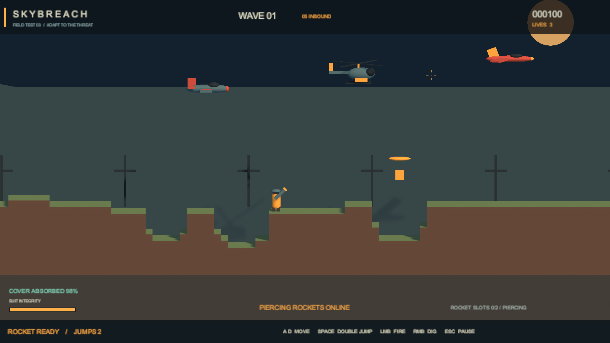
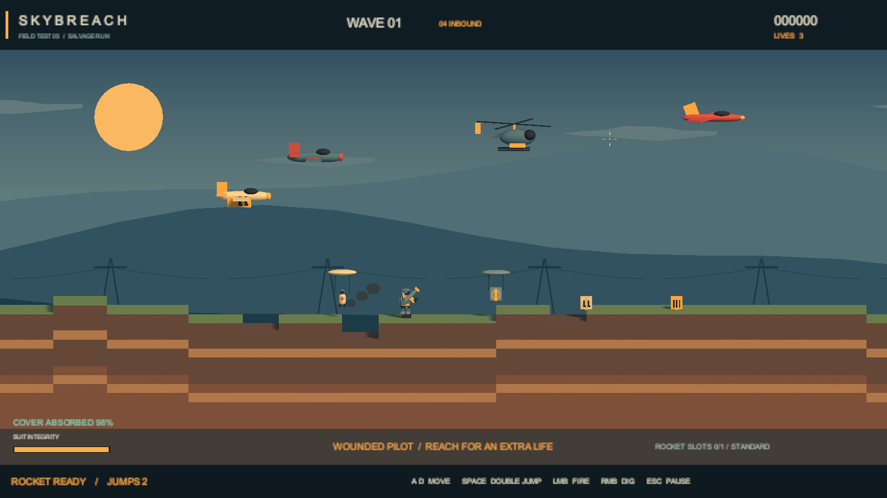

# v0.4 美术方向

方向为黄昏工业荒原，使用自制低模几何、无贴图材质和分层色彩。玩家采用暖橙色装备，普通机与直升机采用冷灰绿，高速机采用红色；背景保持较低对比，让玩家、弹体和预警线容易辨认。

天空由顶端深蓝过渡到地平线的灰青色，低位落日位于界面下方。三层远山、云和电力设施使用不同的水平视差。地形剖面表现表层草皮、砂土、深层土和岩层，新挖出的表面保留裸土。

人物由分节部件组成，行走时更新腿部动作，空中使用不同姿态，倒地和复活有单独反馈。模型是物理胶囊的子对象，外观变化不改变胶囊高度、半径与武器发射点。

爆炸包含短促闪光、冲击波、烟尘和碎屑。效果总量限制为 16 组并复用，到期隐藏回收；数量限制是资源保护措施，不是帧率保证。

后续替换模型时沿用角色轮廓、敌我配色和画面层次，并检查枪口、碰撞体及动画与现有玩法的对应关系。

本版未引入外部模型、贴图或生成图片。天空着色器、场景几何、人物及特效代码均在工程内。

## v0.3 留存画面

## v0.5 补给与救援演示

两张均为安排过敌机和坑洞的运行场景预览，不代表人工游玩录像或性能测试。

## v0.5.1 当前新局画面

这张为实际新局启动后的离屏画面，未安排敌机或坑洞。第一波只生成一架普通机，画面用于检查开局投入，不是人工游玩录像或性能测量。

当前保留浅椭圆开挖规则，地形消耗调整见 [平衡说明](TERRAIN_BALANCE.md)。暖色补给机、四类货物符号及带降落伞的受伤飞行员仍保留，玩法见 [补给与救援说明](SUPPLY_AND_RESCUE.md)。
