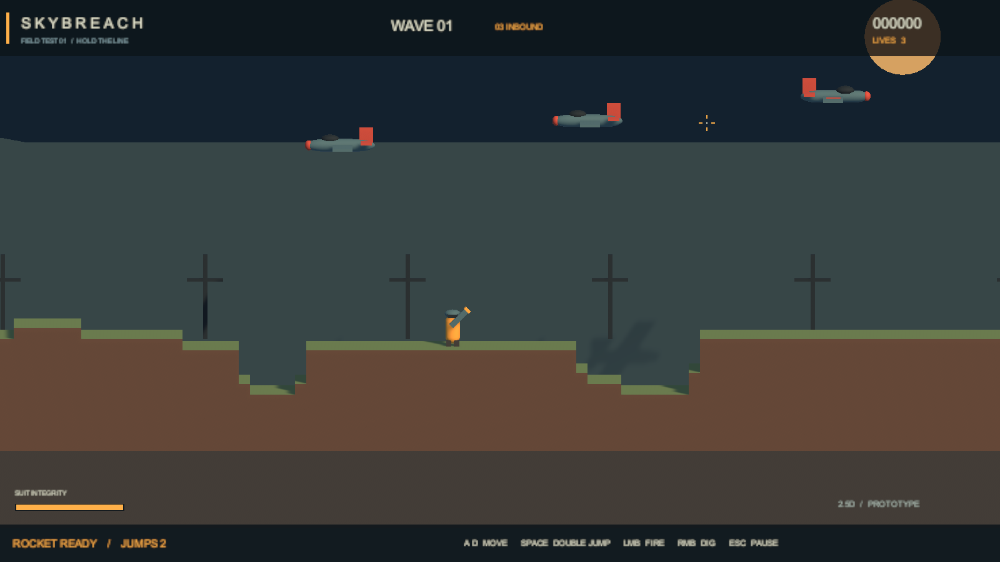

# Airstrike / SKYBREACH

基于 Unity 6.3 的侧视 2.5D 空袭生存原型：控制地面士兵移动、跳跃和挖掘，用火箭击落敌机，并躲避轰炸。

当前版本为可试玩的 v0.1。主分支已由 Godot 工程切换为 Unity；旧版本保留在[历史提交](https://github.com/Yixuan-Tao/Airstrike/tree/8a4cc94ae6e95015b24b92bd49b9a5f1b46c8091)中。



预览来自真实运行场景；为展示画面调整过敌机位置和坑洞，不是人工实玩录像。人物、飞机和界面使用自制简模及占位美术。

## 已实现

- 左右移动、二段跳、鼠标瞄准和火箭射击。
- 一枚火箭同时在空中，命中或消失后可再次发射。
- 敌机循环飞行、投弹、爆炸伤害及击杀计分。
- 受距离限制的挖掘，爆炸坑洞，以及实时更新的地形碰撞。
- 波次推进、三条生命、复活保护、暂停、结算和重新开始。
- 第 4 波开始可能出现装甲飞机。
- 代码合成音效与本机最高完成波数记录。

本原型依据玩法规则独立实现，没有导入原 APK 的代码、图像或音频。补给升级、特殊敌机、坠机残骸、完整设置及最终美术尚未实现。地形目前是 0.5 单位网格的三维剖面，边缘呈阶梯状。

## 在 Unity 中试玩

1. 安装并激活适用许可的 Unity **6000.3.27f2**。
2. 用 Unity Hub 打开仓库根目录，等待依赖导入。
3. 打开 `Assets/Scenes/Prototype.unity`，进入 Play Mode。

| 操作 | 按键 |
|---|---|
| 移动 | A / D 或左右方向键 |
| 跳跃、空中再跳 | 空格、W 或上方向键 |
| 瞄准 | 鼠标 |
| 火箭射击 | 鼠标左键，可按住 |
| 附近挖掘 | 鼠标右键，可按住 |
| 暂停 / 继续 | Esc |
| 重新开始 | R |
| 退出独立程序 | 暂停或结算时按 Q，或关闭窗口 |

清空本波全部敌机和炸弹后进入下一波。飞出画面的敌机会再次飞越战场，需要击落才能清空威胁。

## Windows 构建

仓库保存源工程，编译产物与 Unity 缓存不入库。构建完成后可双击根目录的 `试玩.cmd`；复制给其他电脑时需要整个 `Builds/Skybreach` 文件夹。

环境：Universal RP **17.3.0**、Pipeline **0.9.1-exp.1**，目标 Windows x64 / Mono。开发时使用的 Unity CLI 版本为 **1.0.0-beta.15**。

已安装官方 Unity CLI 后，在仓库根目录运行 PowerShell：

```powershell
$cli = 'unity'
$projectPath = (Get-Location).Path
New-Item -ItemType Directory -Force -Path 'Logs' | Out-Null
$editorArgs = '-logFile "' + (Join-Path $projectPath 'Logs/BackgroundEditor.log') + '" -job-worker-count 4'
& $cli open $projectPath --editor-version 6000.3.27f2 --batchmode --until-ready --timeout 60 --args $editorArgs --format json
& $cli command build run --project-path $projectPath --format json -- --target StandaloneWindows64 --outputPath Builds/Skybreach/Skybreach.exe --scenes '["Assets/Scenes/Prototype.unity"]' --confirm true
& $cli command build status --project-path $projectPath --format json
```

构建是异步操作，等待状态为 `completed` 且结果为 `Succeeded` 后运行：

```powershell
& './AgentScripts/VerifyStandalone.ps1'
```

验收通过游戏内部控制输入操作真实物理与战斗逻辑，隐藏运行独立程序，不发送系统键鼠事件。后台模式忽略用户在其他软件中的键鼠操作。

## 验证记录

2026-11-01 在 Windows 上的最终构建成功，零错误、零警告；独立程序退出码为 0，23 条自动检查通过。

记录见 [验收摘要](Docs/Validation/README.md)、[独立运行原始结果](Docs/Validation/standalone.json)和[构建汇总](Docs/Validation/acceptance.json)。这些是本地执行记录，不是 GitHub Actions 验证。

检查覆盖移动、二段跳及次数限制、落地恢复、敌机飞行投弹、挖掘、火箭命中与数量限制、爆炸伤害、击杀计分、波次推进、暂停继续、死亡复活、结算和重开。射击检查将目标固定位置以便重复，正常飞行与投弹另行检查。

独立验收使用无图形、无声音模式；键鼠手感、声音和长时间图形性能仍需人工试玩。后台帧计数不是性能基准。

## 工程结构

- `Assets/Scenes/Prototype.unity`：游戏入口；运行时生成战场。
- `Assets/Scripts/`：操作、战斗、敌机、地形、界面及可选验收驱动。
- `Assets/Art/Prototype/`：引用到构建中的材质。
- `AgentScripts/BuildPrototype.cs`：通过 Unity API 重建入口和材质。
- `AgentScripts/CapturePrototype.cs`、`ArrangePreview.cs`：后台离屏预览。
- `AgentScripts/VerifyStandalone.ps1`：独立程序自动验收。
- `Packages/`、`ProjectSettings/`：锁定依赖与项目设置。
- `Bootstrap.unity` 与对应脚本：早期环境核验，非游戏入口。

通过 CLI 重启编辑器后，先明确打开 `Assets/Scenes/Prototype.unity`，再开始 Play Mode。持久脚本修改后先确认编译完成；场景与材质通过 Unity API 保存。

## 素材与许可

[NVIDIA SimReady](https://huggingface.co/datasets/nvidia/simready-assets) 和 [Scenario 3D Collection](https://huggingface.co/datasets/scenario-labs/3d-collection) 列为后续素材候选，本版未导入其模型。来源与选用记录见 [ASSET_SOURCES.md](ASSET_SOURCES.md)。

沿用仓库原有 [MIT License](LICENSE)。Unity 及包依赖遵循各自随附的许可。
